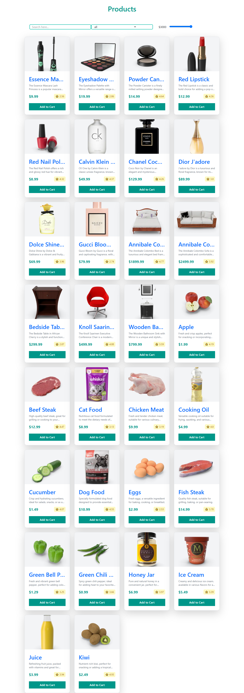
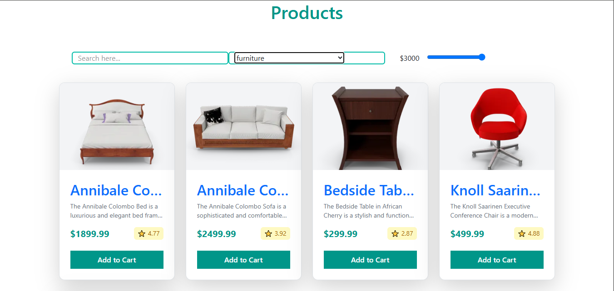
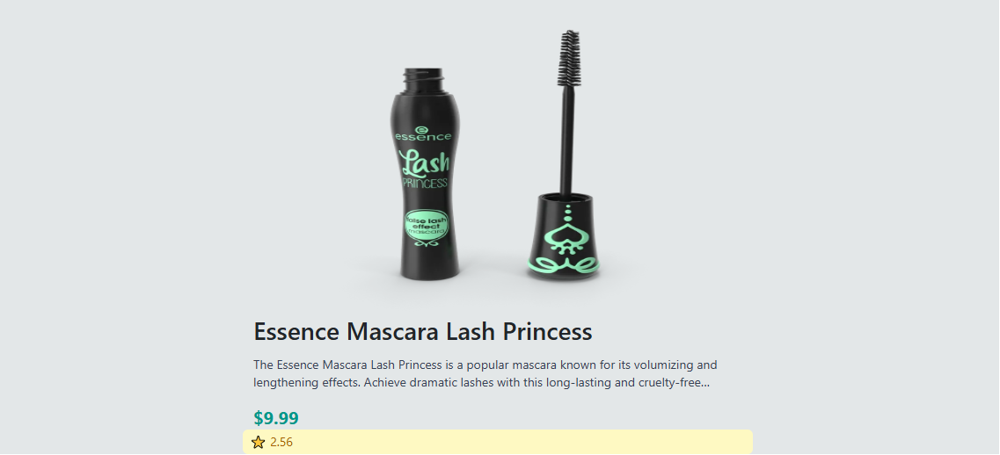

# 🛒 E-Commerce Shopping & Product Discovery App

A modern, fast, and interactive E-Commerce web application built with **React**, **React Router v6**, **Axios**, and **Tailwind CSS v4**. This application dynamically fetches product data from an external REST API ([DummyJSON](https://dummyjson.com/)), allowing users to filter products by category, search query, and maximum price, as well as view detailed information for individual products.

---

## 📸 Visual Overview

  
*Figure 1: Main Product Storefront featuring real-time filtering, category selection, and price range controls.*

---

## 🛠️ Project Setup & Entry Point

### 1. `index.js` (or `main.jsx`) – Application Bootstrapper

This is the entry point of the React application, where the root React component tree mounts to the HTML DOM.

```jsx
import React from 'react';
import ReactDOM from 'react-dom/client';
import App from './App';
import { BrowserRouter } from 'react-router-dom';
import './index.css';

const root = ReactDOM.createRoot(document.getElementById('root'));
root.render(
  <React.StrictMode>
    <BrowserRouter>
      <App />
    </BrowserRouter>
  </React.StrictMode>
);
```

#### 🔍 Line-by-Line Breakdown:
* `import React from 'react';`: Imports the core React library required for JSX compilation and React features.
* `import ReactDOM from 'react-dom/client';`: Imports the modern React 18+ client rendering engine.
* `import App from './App';`: Imports the primary root component containing all routing logic.
* `import { BrowserRouter } from 'react-router-dom';`: Imports `BrowserRouter`, which provides client-side routing via the HTML5 history API (`pushState`, `replaceState`, and `popstate` events).
* `import './index.css';`: Imports global styling rules and Tailwind CSS directives.
* `const root = ReactDOM.createRoot(...)`: Selects the `<div id="root"></div>` HTML element and initializes a React concurrent root.
* `<React.StrictMode>`: A developer tool wrapper that performs checks and logs warnings for potential problems (e.g., side-effect checks, deprecated lifecycle methods).
* `<BrowserRouter><App /></BrowserRouter>`: Wraps the main `App` component inside `BrowserRouter` so that route switching, URL parameters, and navigation hooks function throughout the application hierarchy.

---

### 2. `index.css` – Styling Rules

Configures Tailwind CSS utilities and global override rules.

```css
@import "tailwindcss";

/* Remove text-decoration from the Link and all elements inside it */
.no-underline,
.no-underline-all,
.no-underline-all * {
  text-decoration: none !important;
}
```

#### 🔍 Line-by-Line Breakdown:
* `@import "tailwindcss";`: Integrates Tailwind CSS v4 framework styling rules into the build system.
* `.no-underline, .no-underline-all, .no-underline-all *`: Custom CSS utility classes ensuring that React Router `Link` tags and their children do not display standard hyperlink underlines (`text-decoration: none !important`).

---

## 🗂️ Data & Routing Structure

### 3. `Category.js` – Product Categories Export

Stores static configuration data used across the store filter interface.

```javascript
export const productCategories = ["all", "beauty", "furniture", "fragrances", "grocery"];
```

#### 🔍 Explanation:
* `export const productCategories`: Exports an array of strings representing available product categories.
* `"all"` acts as a reset option to view products across all categories simultaneously.

---

### 4. `App.js` – Central Routing Module

Defines client-side routes using `react-router-dom`.

```jsx
import { Routes, Route } from 'react-router-dom'
import Ecommerce from './filteredShoppingCart/Ecommerce.jsx'
import ProductsDetail from './filteredShoppingCart/ProductsDetail.jsx'

const App = () => {
  return (
    <>
      <Routes>
        <Route path="/" element={<Ecommerce />} />
        <Route path="/ecommerce" element={<Ecommerce />} />
        <Route path="/ecommerce/:id" element={<ProductsDetail />} />
      </Routes>
    </>
  )
}

export default App
```

#### 🔍 Line-by-Line Breakdown:
* `import { Routes, Route } from 'react-router-dom'`: Imports routing components:
  * `<Routes>`: Parent container that evaluates location changes and renders the best matching child `<Route>`.
  * `<Route>`: Defines a mapping between a URL path pattern and a React component element.
* `import Ecommerce from ...` & `import ProductsDetail from ...`: Imports the store catalog view and the dynamic product details page.
* `<Route path="/" element={<Ecommerce />} />`: Renders the main catalog at the site root (`/`).
* `<Route path="/ecommerce" element={<Ecommerce />} />`: Alias route for the main catalog.
* `<Route path="/ecommerce/:id" element={<ProductsDetail />} />`: Dynamic route pattern where `:id` acts as a variable parameter capturing the selected product ID (e.g., `/ecommerce/1`).

---

## ⚡ Core Pages & Components

### 5. `Ecommerce.jsx` – Product Listing & Real-Time Filtering

This component acts as the main shop page. It handles asynchronous data fetching, multi-criteria client-side state filtering, and card rendering.

  
*Figure 2: Real-time user controls for refining catalog results.*

#### Code Implementation:

```jsx
import { useEffect, useState } from "react"
import axios from "axios"
import { Link } from "react-router-dom"
import { productCategories } from './Category'

const Ecommerce = () => {
  const [products, setProducts] = useState([]);
  const [filteredproducts, setFilteredProducts] = useState([]);
  const [search, setSearch] = useState("");
  const [category, setCategory] = useState("all");
  const [price, setPrice] = useState(3000);

  useEffect(() => {
    const getAllProducts = async () => {
      try {
        const { data } = await axios.get("https://dummyjson.com/products")
        setProducts(data.products)
      } catch (error) {
        console.log(error);
      }
    }
    getAllProducts()
  }, [])

  useEffect(() => {
    let result = products;

    if (search !== "") {
      const normalizedSearch = search.toLowerCase().trim();
      result = result.filter((product) => product.title.toLowerCase().includes(normalizedSearch));
    }

    if (category !== "all") {
      result = result.filter(product => product.category === category)
    }

    result = result.filter(product => product.price <= price)

    setFilteredProducts(result);
  }, [products, search, category, price])

  return (
    <>
      <div className='text-4xl font-bold text-teal-600 text-center my-6'>
        <h1>Products</h1>
      </div>

      <div className="container mx-auto px-4">
        <div className="filters">
          <div className="row p-10 flex items-center justify-between">
            <div className="col-lg-4 col-md-6 col-12 border-2 border-teal-500 rounded-md">
              <input 
                type="search" 
                placeholder="Search here..." 
                className="w-80"  
                value={search} 
                onChange={(e) => setSearch(e.target.value)}
              />
            </div>
            <div className="col-lg-4 col-md-6 col-12 border-2 border-teal-500 rounded-md">
              <select 
                value={category} 
                onChange={(e) => setCategory(e.target.value)} 
                className="w-60 border-none"
              >
                {productCategories.map((cat) => (
                  <option key={cat} value={cat}>{cat}</option>
                ))}
              </select>
            </div>
            <div className="col-lg-4 col-md-6 col-12">
              <label className="price-label w-20 pl-5">${price}</label>
              <input 
                type="range" 
                min="0" 
                max="3000" 
                value={price} 
                onChange={(e) => setPrice(Number(e.target.value))}  
                className="price-bar"
              />
            </div>
          </div>
        </div>

        <div className="grid grid-cols-1 sm:grid-cols-2 md:grid-cols-3 lg:grid-cols-4 gap-6">
          {filteredproducts.map((product) => (
            <div key={product?.id} className="bg-white rounded-xl shadow-lg overflow-hidden hover:shadow-2xl transition-shadow duration-300 border border-gray-200">
              <Link to={`/ecommerce/${product.id}`} className="block no-underline no-underline-all">
                <div className="h-48 overflow-hidden bg-gray-100">
                  
                </div>
                <div className="p-4">
                  <h2 className="text-lg font-semibold text-gray-800 truncate">{product?.title}</h2>
                  <p className="text-sm text-gray-500 mt-1 line-clamp-2">{product?.description}</p>
                  <div className="flex items-center justify-between mt-3">
                    <span className="text-xl font-bold text-teal-600">${product?.price}</span>
                    <span className="text-sm bg-yellow-100 text-yellow-700 px-2 py-1 rounded-md flex items-center gap-1">
                      <span>⭐</span> {product?.rating}
                    </span>
                  </div>

                  <button className="mt-4 w-full bg-teal-600 text-white py-2 rounded-lg hover:bg-teal-700 transition-colors duration-200 font-medium cursor-pointer">
                    Add to Cart
                  </button>
                </div>
              </Link>
            </div>
          ))}
        </div>
      </div>
    </>
  )
}

export default Ecommerce
```

#### 🔍 Detailed Method & State Analysis:

1. **State Declarations (`useState` Hook)**:
   * `products`: Master array holding the unfiltered list of items retrieved from the API.
   * `filteredproducts`: Derived array containing items currently displayed after applying search, category, and price criteria.
   * `search`: String state bound to the text search input field.
   * `category`: String state keeping track of the selected category dropdown option.
   * `price`: Numeric state bound to the range input control determining maximum product price.

2. **Data Fetching Hook (`useEffect` - Mount)**:
   * **`useEffect(() => { ... }, [])`**: Runs once when the component mounts due to the empty dependency array `[]`.
   * **`axios.get("https://dummyjson.com/products")`**: Executes an HTTP `GET` request to fetch product datasets.
   * **`destructuring ({ data })`**: Extracts the response object's `data` payload.
   * **`setProducts(data.products)`**: Populates the master state array with products.

3. **Multi-Filter Engine (`useEffect` - Updates)**:
   * **`useEffect(() => { ... }, [products, search, category, price])`**: Fires whenever any of these state values change.
   * **Search Normalization**: `.toLowerCase().trim()` eliminates whitespace and enables case-insensitive string matching using `.includes()`.
   * **Category Filter**: Filters array elements where `product.category === category`. Skipped if `"all"` is selected.
   * **Price Range Filter**: Retains products satisfying `product.price <= price`.

4. **JSX Template & Event Listeners**:
   * **`onChange={(e) => setSearch(e.target.value)}`**: Captures user input events in real time to update state variables.
   * **`productCategories.map(...)`**: Dynamically maps over category strings to build standard HTML `<option>` elements.
   * **`filteredproducts.map(...)`**: Iterates through the filtered products and renders styled Tailwind card components.
   * **`<Link to={`/ecommerce/${product.id}`}>`**: React Router wrapper enabling seamless dynamic navigation to specific item pages upon click.

---

### 6. `ProductsDetail.jsx` – Dynamic Product View Page

Fetches and displays detailed information for a single product based on the route parameter `:id`.

  
*Figure 3: Dedicated detailed view driven by dynamic URL parameter fetching.*

#### Code Implementation:

```jsx
import axios from "axios"
import { useEffect, useState } from "react"
import { useParams } from "react-router-dom"

const ProductsDetail = () => {
  const [product, setProductsDetail] = useState();
  const { id } = useParams();

  useEffect(() => {
    const fetchData = async () => {
      try {
        const { data } = await axios.get(`https://dummyjson.com/products/${id}`)
        console.log(data);
        setProductsDetail(data)
      } catch (error) {
        console.log(error);
      }
    }
    fetchData()
  }, [id]) 

  return (
    <>
      <div className="container mt-10">
        <div className="row max-w-fit px-70 bg-mist-200">
          
          <h3>{product?.title}</h3>
          <p className="text-sm text-gray-700 mt-1 line-clamp-2">{product?.description}</p> 
          <span className="text-xl font-bold text-teal-600">${product?.price}</span>
          <span className="text-sm bg-yellow-100 text-yellow-700 px-2 py-1 rounded-md flex items-center gap-1">
            <span>⭐</span> {product?.rating}
          </span>
        </div>
      </div>
    </>
  )
}

export default ProductsDetail
```

#### 🔍 Detailed Method & State Analysis:

1. **`useParams()` Hook**:
   * Reads key-value pairs of dynamic parameters from the current URL defined in `<Route path="/ecommerce/:id" />`.
   * `const { id } = useParams()` extracts the ID value (e.g., `1`, `2`) directly into the local scope.

2. **Single Product Fetching Effect**:
   * **`useEffect(() => { ... }, [id])`**: Triggers whenever the component mounts or the `id` parameter changes.
   * **`axios.get("https://dummyjson.com/products/${id}")`**: Makes a targeted REST call to fetch only the specified product's attributes.
   * **`setProductsDetail(data)`**: Stores the product object into local state.

3. **Optional Chaining (`?.`)**:
   * Prevents runtime exceptions (`TypeError: Cannot read properties of undefined`) while asynchronous network requests are pending.
   * **`product?.images?.[0]`**: Safely attempts to access the first element of the images array only when `product` and `images` are loaded.

---

## 🔑 Key Features Summary

* ⚡ **Client-Side Routing**: Smooth navigation without full browser reloads using React Router v6.
* 🔍 **Real-Time Text Search**: Instant filtering on product titles.
* 🏷️ **Category Sorting**: Direct isolation of items based on chosen category specifications.
* 💵 **Dynamic Range Slider**: Dynamic price filtration via reactive range controls.
* 📦 **Dynamic Product Page**: Asynchronous fetch of individual item detailed metadata driven by URL routes.
* 🎨 **Tailwind CSS Styling**: Modern, responsive layout structures with micro-interactions.
